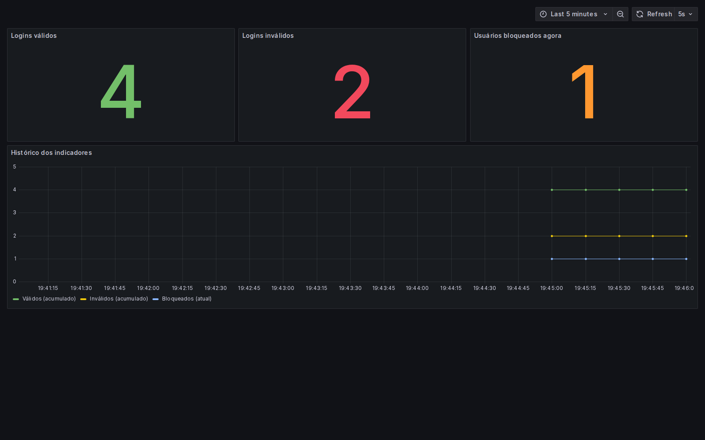

# Login REST com Spring Boot e Grafana

Projeto acadêmico com Spring Boot 3.5.7, Java 17, Spring Security, JdbcUserDetailsManager, JDBC/H2 persistente, BCrypt, OpenAPI/Swagger, Micrometer, Prometheus e Grafana.

## Executar tudo

Instale Docker Desktop com Docker Compose. Na pasta do projeto:

```sh
docker compose up --build -d
```

- Swagger: http://localhost:8080/swagger-ui/index.html
- OpenAPI JSON: http://localhost:8080/v3/api-docs
- Grafana: http://localhost:3000/d/login-security
- Grafana: usuário `admin`, senha **de demonstração** `Grafana123!`.

Aguarde a inicialização e alguns segundos para a coleta do Prometheus. O datasource e o dashboard são provisionados automaticamente. A API expõe métricas em `api:9091/actuator/prometheus`, acessíveis pela rede interna do Compose. Não é necessário importar o dashboard para executar com Compose.

## Usuários de demonstração

| Username | Senha de demonstração | Role |
|---|---|---|
| admin | Admin123! | ROLE_ADMIN |
| manutencao | Manut123! | ROLE_MANUTENCAO |
| aluno | Aluno123! | ROLE_USER |

São criados somente com `APP_DEMO=true`, ativado no Compose para a atividade. As contas existentes não são sobrescritas em reinicializações. Essas senhas são públicas e exclusivas para demonstração local. Desative a carga de demonstração e cadastre administradores por procedimento administrativo antes de qualquer implantação real. Use HTTPS fora de localhost. O Compose publica as portas somente em 127.0.0.1.

## Endpoints

`userid` significa **username**, pois o SQL original usa username como chave primária; não foi inventado um ID numérico.

| Método e rota | Corpo | Acesso | Respostas principais |
|---|---|---|---|
| POST /login | `{"username":"aluno","senha":"Aluno123!"}` | Público | 200 ou 401 |
| PUT /trocarsenha/{userid} | `{"atual":"Aluno123!","nova":"Nova123!"}` | Público, exige senha atual | 200 ou 401 |
| POST / | `{"username":"novo","senha":"Nova123!"}` | ROLE_MANUTENCAO | 201, 400, 401, 403, 409 |
| PUT /unlock/{userid} | Sem corpo | ROLE_ADMIN | 200, 401, 403, 404 |
| GET / | Sem corpo | ROLE_MANUTENCAO | 200, 401, 403 |

Autenticação das rotas protegidas: **HTTP Basic**, enviando username/senha em cada chamada. No Swagger, clique em **Authorize** e informe a conta apropriada. `POST /login` valida as credenciais, mas não cria sessão ou token. As roles são consultadas no banco via JdbcUserDetailsManager; novos usuários recebem apenas ROLE_USER. O cliente não escolhe a role pelo JSON. O administrador não recebe automaticamente a role de manutenção.

`GET /` retorna username, bloqueado, tentativasFalhas e roles. Senhas e hashes nunca são expostos. JSON malformado ou campos inválidos retornam 400. Username aceita letras, números, `_`, `.` e `-`, com até 100 caracteres. Senhas não podem ser vazias e têm no máximo 72 bytes UTF-8 (limite do BCrypt). Tentativas válidas de autenticação acima desse limite são rejeitadas sem truncar a senha.

## Bloqueio e consistência

- Duas falhas consecutivas bloqueiam o usuário; não há desbloqueio automático.
- Uma autenticação válida zera as falhas consecutivas.
- Login com senha correta de conta bloqueada continua retornando 401.
- HTTP Basic usa a mesma verificação e não contorna bloqueios.
- A validação da senha atual também registra falhas para evitar força bruta pela rota pública de troca de senha. A troca em si não é um evento de login e não incrementa os contadores de login.
- Só ROLE_ADMIN pode desbloquear, zerando tentativas e datas do bloqueio.
- Usuários inexistentes retornam 401 genérico e incrementam logins inválidos, mas não criam contas fictícias em login_attempts.
- Transações e bloqueio da linha com `SELECT ... FOR UPDATE` serializam mudanças por usuário, evitando perda de falhas concorrentes. Exceções de autenticação HTTP Basic são lançadas depois do commit da falha.

## Ajustes no SQL fornecido

O script completo está em `src/main/resources/schema.sql`.

1. Removida a vírgula depois de `updated_at`, que tornava o SQL inválido.
2. `senha VARCHAR(10)` foi ampliado para `VARCHAR(255)` para comportar o hash BCrypt, sem armazenar texto puro.
3. Acrescentado `enabled`, necessário às consultas adaptadas do JdbcUserDetailsManager.
4. Acrescentada `authorities` para armazenar as roles.
5. Mantida `login_attempts` com os campos solicitados e chave estrangeira para usuarios.
6. Acrescentada `auth_metrics`, pois a tabela original não tem campos para totais acumulados de logins válidos/inválidos. Reiniciar a aplicação não zera esses contadores.

O banco é H2 em arquivo, preservado no volume Docker `api-data`. `schema.sql` foi feito para banco novo; não é uma migração de uma base antiga com senha em texto puro. Excluir os volumes apaga os dados e os indicadores.

## Métricas e dashboard

| Métrica Prometheus | Significado |
|---|---|
| auth_logins_valid_total | Total persistente de autenticações bem-sucedidas |
| auth_logins_invalid_total | Total persistente de autenticações rejeitadas |
| auth_users_locked | Total atual de usuários bloqueados |

Os contadores incluem POST /login **e autenticações HTTP Basic**, inclusive uma autenticação válida que termine em 403 por falta de role. JSON inválido (400), requisição sem Basic e troca de senha não contam como logins. Bloqueados é um gauge, não um histórico acumulado de bloqueios. O dashboard considera uma instância da API, como no Compose.

O arquivo `monitoring/grafana/dashboards/login-dashboard.json` é o JSON importável/provisionável. O print real está em `docs/dashboard-grafana.png` e a exportação via API em `docs/dashboard-exportado.json`. A imagem foi capturada pelo Grafana Image Renderer 3.12.6 no Grafana 11.6.0, consultando o Prometheus real. O cenário exibido tem 4 autenticações válidas (1 Basic do admin + 3 logins do aluno), 2 inválidas e 1 usuário bloqueado.



### Gerar dados para apresentação

```sh
python3 scripts/demo.py
```

O script autentica aluno, envia duas senhas erradas e deixa aluno bloqueado para o print. Ele primeiro tenta desbloquear aluno usando admin, para poder ser repetido. Requer as contas de demonstração com as senhas originais. Espere 5–10 segundos e atualize o Grafana.

### Exportar e importar

Como o enunciado não trouxe o link das instruções mencionadas, foi adotado o formato JSON nativo do Grafana. Abra o dashboard, escolha **Share/Export** (ou o menu de exportação da sua versão), exporte como JSON e salve. Para importar em outra instalação, use **Dashboards → New → Import**, envie o JSON e configure um datasource Prometheus com UID `prometheus`. O JSON não contém senhas.

Alternativa pela API, com credencial de demonstração local:

```sh
python3 scripts/export_dashboard.py
```

## Rodar sem Docker e testar

Requisitos: JDK 17 e Maven 3.9+.

```sh
mvn verify
mvn spring-boot:run -Dspring-boot.run.arguments=--app.demo=true
```

Sem Docker, a API funciona normalmente; Prometheus e Grafana precisam ser executados à parte. Configure o alvo Prometheus como `localhost:9091` e seu datasource Grafana como `http://localhost:9090`. O gerenciamento usa a porta 9091, separada da aplicação (8080).

Os testes de integração usam H2 em memória e verificam autenticação, permissões, cadastro, proteção de hashes, troca de senha, desbloqueio, concorrência e documentação. A configuração de Mockito usa o mecanismo de subclasses para executar sem anexar um agente à JVM; os testes exercitam a aplicação e banco reais, sem mocks de autenticação. O GitHub Actions executa `mvn verify` em cada push/PR.

## Publicar em repositório público

Crie um repositório vazio com visibilidade **Public**, depois execute nesta pasta:

```sh
git init -b main
git add .
git commit -m "Implementa login REST, roles, bloqueio e Grafana"
git remote add origin https://github.com/SEU_USUARIO/login-spring-grafana.git
git push -u origin main
```

Confirme que `docs/dashboard-grafana.png` e a exportação JSON estão versionados antes de entregar o link. `target/`, `.env` e o banco local são ignorados pelo Git.

## Referências técnicas

- https://docs.spring.io/spring-security/reference/servlet/authentication/passwords/jdbc.html
- https://springdoc.org/v2/
- https://grafana.com/docs/grafana/latest/administration/provisioning/

## Validação da entrega

`mvn verify`: BUILD SUCCESS, 12 testes executados, nenhuma falha ou erro. Evidência em `docs/testes-integracao.txt`. API, Prometheus e Grafana foram executados como processos locais para gerar o print e a exportação. O Docker Compose foi validado estruturalmente, mas não executado neste ambiente, que não dispõe de Docker.
